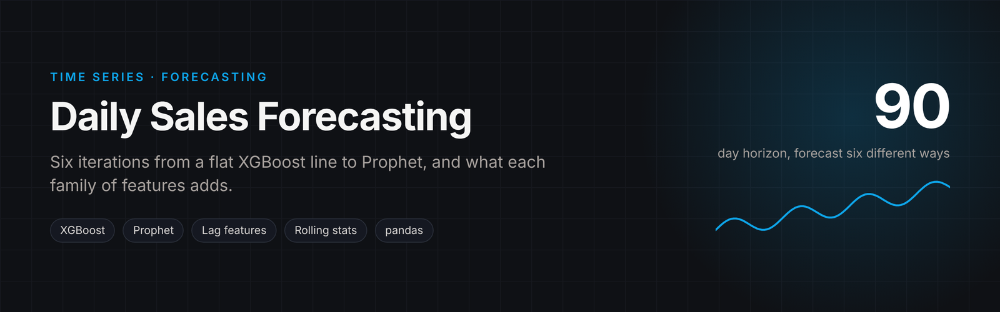
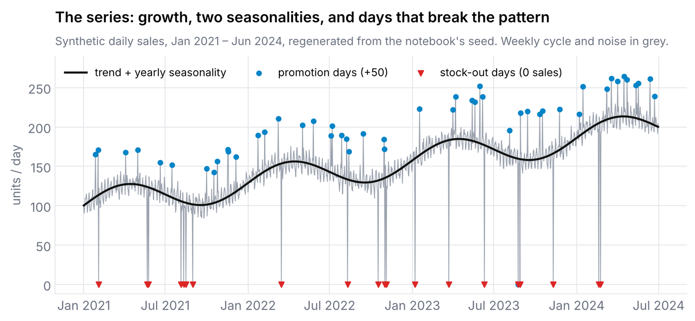
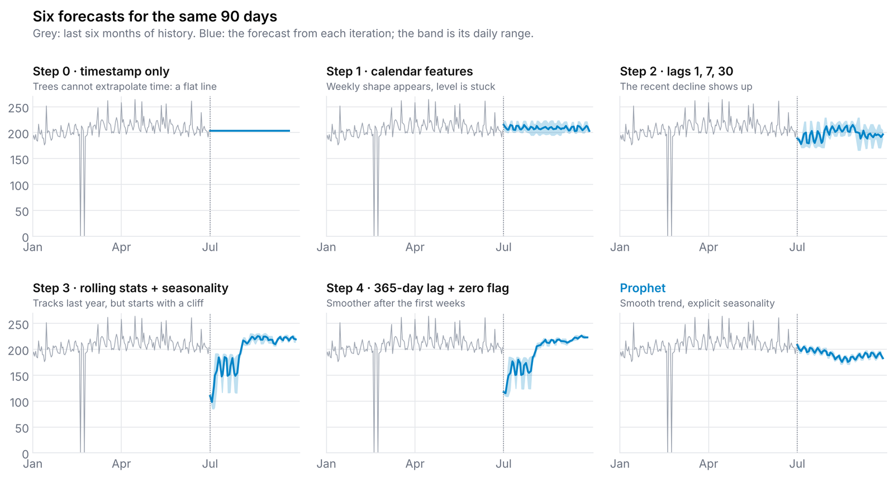

<p align="center"></p>

# Daily Sales Forecasting: XGBoost Feature Engineering vs. Prophet

A 90-day forecast for a daily sales series, built up iteratively to show what each family of
time-series features contributes, and then benchmarked against Prophet.

**Notebook:** [`sales_forecasting.ipynb`](sales_forecasting.ipynb)

## The data

A synthetic daily series from January 2021 to June 2024, generated in the notebook with a fixed
seed: linear growth, weekly and yearly seasonality, noise, 50 promotion days and 20 zero-sales
stock-out days.

<p align="center"></p>

## Iterations

| Step | Features | What changed |
|---|---|---|
| 0 | timestamp only | a flat, uninformative forecast: trees cannot extrapolate time |
| 1 | day of week, month, year | captures calendar effects, dominated by `Year` |
| 2 | lags 1, 7, 30 | the **AR** component; the recent downward trend becomes visible |
| 3 | 7-day rolling mean/std + cyclical seasonality | the **MA** component; last year's pattern is tracked better |
| 4 | 365-day lag + last-year-zero flag | lets the model anticipate recurring closure days |
| 5 | **Prophet** | smooth trend with explicit weekly and yearly seasonality |

<p align="center"></p>
<p align="center"><sub>History regenerated from the seed; forecasts traced from the notebook's own plots, so the shapes are the notebook's results redrawn in one style.</sub></p>

The cliff at the start of steps 3 and 4 is a feature-construction bug worth showing rather
than hiding: the future lag and rolling features are computed only from forecasts inside the
90-day window, never from the last real observations, so the 30-day lag is empty for the
whole first month and the model under-forecasts until it fills. Seeding the future features
from the tail of the history is the fix.

## Takeaways

- Gradient-boosted trees need the time-series structure handed to them as features: lags,
  rolling statistics and seasonal encodings are what turn XGBoost into a forecaster.
- Recursive forecasting with lag features needs care: future lags have to come from earlier
  predictions, which compounds error over a 90-day horizon.
- For a series dominated by trend and seasonality, Prophet gives a cleaner, more realistic
  forecast with far less feature work. XGBoost earns its place once exogenous drivers
  (promotions, price, weather) enter the picture.

## Run it

```bash
pip install -r requirements.txt
jupyter notebook sales_forecasting.ipynb
```
